# SDF算法流程图

本文档详细展示了SDF工具的核心算法流程，包括单张SDF计算、多图混合和光照预览的完整过程。

## SDF算法流程图

```mermaid
flowchart TD
    Start([开始]) --> InputImages[导入多张图像]
    InputImages --> ValidateImages{验证图像格式}
    ValidateImages -->|失败| ErrorMsg[显示错误信息]
    ValidateImages -->|成功| PreprocessImages[图像预处理]
    
    PreprocessImages --> Threshold[二值化处理<br/>threshold = 0.5]
    Threshold --> SingleSDF[计算单张SDF]
    
    subgraph "单张SDF计算"
        SingleSDF --> CheckDirection{检查计算方向}
        CheckDirection -->|inside| InsideOnly[只计算内部距离]
        CheckDirection -->|outside| OutsideOnly[只计算外部距离]
        CheckDirection -->|both| BothDirection[双向计算]
        
        BothDirection --> InsideDist[计算内部距离变换<br/>cv2.distanceTransform]
        InsideDist --> OutsideDist[计算外部距离变换<br/>cv2.distanceTransform]
        OutsideDist --> Normalize8SSEDT[8SSEDT归一化<br/>外部:0-0.5, 边界:0.5, 内部:0.5-1]
        
        InsideOnly --> InsideNorm[内部归一化<br/>0-0.5范围]
        OutsideOnly --> OutsideNorm[外部归一化<br/>0.5-1范围]
        
        Normalize8SSEDT --> CheckInvert{是否反转?}
        InsideNorm --> CheckInvert
        OutsideNorm --> CheckInvert
        CheckInvert -->|是| InvertSDF[反转SDF值<br/>1.0 - sdf]
        CheckInvert -->|否| SingleResult[单张SDF结果]
        InvertSDF --> SingleResult
    end
    
    SingleResult --> CheckBackend{选择计算后端}
    CheckBackend -->|C++| CppCompute[C++高性能计算<br/>sdf_core.compute_single_sdf]
    CheckBackend -->|Python| PythonCompute[Python计算<br/>SDFCoreAlgorithm.compute_sdf_python]
    
    CppCompute --> CollectSDF[收集所有单张SDF]
    PythonCompute --> CollectSDF
    
    CollectSDF --> CheckMultiple{是否多张图像?}
    CheckMultiple -->|单张| FinalResult[最终SDF结果]
    CheckMultiple -->|多张| BlendSDF[SDF混合处理]
    
    subgraph "SDF混合算法"
        BlendSDF --> PairwiseBlend[相邻帧混合算法<br/>两两SDF混合]
        PairwiseBlend --> BlendLoop[逐对混合<br/>blend_two_sdfs]
        BlendLoop --> BlendResult[混合结果]
    end
    
    BlendResult --> FinalResult
    FinalResult --> LightingPreview[光照效果预览]
    
    subgraph "光照预览算法"
        LightingPreview --> AngleMapping[角度映射<br/>-180°到180° → 0到1]
        AngleMapping --> CheckAngle{角度 <= 0?}
        CheckAngle -->|是| MirrorSDF[SDF左右镜像<br/>np.fliplr]
        CheckAngle -->|否| NormalSDF[正常SDF采样]
        
        MirrorSDF --> StepFunction[Step函数比较<br/>light_param < sdf_sample]
        NormalSDF --> StepFunction
        StepFunction --> LightResult[黑白光照效果]
    end
    
    LightResult --> Export[导出结果]
    Export --> End([结束])
    
    ErrorMsg --> End
    
    %% 样式定义
    classDef processBox fill:#e3f2fd,stroke:#1976d2,stroke-width:2px
    classDef decisionBox fill:#fff3e0,stroke:#f57c00,stroke-width:2px
    classDef algorithmBox fill:#f3e5f5,stroke:#7b1fa2,stroke-width:2px
    classDef resultBox fill:#e8f5e8,stroke:#388e3c,stroke-width:2px
    classDef errorBox fill:#ffebee,stroke:#d32f2f,stroke-width:2px
    
    class InputImages,PreprocessImages,Threshold,SingleSDF,CollectSDF,BlendSDF,LightingPreview,Export processBox
    class ValidateImages,CheckDirection,CheckInvert,CheckBackend,CheckMultiple,CheckAngle decisionBox
    class InsideDist,OutsideDist,Normalize8SSEDT,PairwiseBlend,AngleMapping,StepFunction algorithmBox
    class SingleResult,BlendResult,FinalResult,LightResult resultBox
    class ErrorMsg errorBox
```



## 算法详解

### 1. 单张SDF计算

#### 8SSEDT算法原理
8SSEDT (8-point Signed Sequential Euclidean Distance Transform) 是项目的核心算法：

1. **二值化处理**: 将输入图像转换为二值图像
2. **距离变换**: 分别计算内部和外部的欧几里得距离
3. **归一化**: 按照特定规则将距离值映射到0-1范围

#### 归一化规则
- **外部区域**: 0 到 0.5 (距离边界越远值越小)
- **边界**: 0.5 (精确的边界位置)
- **内部区域**: 0.5 到 1 (距离边界越远值越大)

### 2. SDF混合算法

#### SDF混合算法

项目使用唯一确认正确的混合策略：

| 策略 | 特点 | 适用场景 | 性能 |
|------|------|----------|------|
| sdf_blend | 相邻帧混合，保持SDF特性 | 多角度光照 | 优化 |

#### 相邻帧混合算法
```
对于N张图像:
1. 第1张和第2张混合 → 结果1
2. 第2张和第3张混合 → 结果2
3. 第3张和第4张混合 → 结果3
...
4. 对所有N-1个混合结果取平均 → 最终结果
```

这种方法保持了SDF的数学特性，确保混合结果的正确性。

### 3. 光照预览算法

#### Shader方式实现
基于GPU shader的光照计算原理：

1. **角度映射**: 将-180°到180°映射到0-1范围
2. **方向判断**: 根据角度决定SDF采样方式
3. **Step函数**: 使用阶跃函数生成硬阴影效果

#### 关键公式
```
light_param = abs(angle / 180.0)
if angle <= 0:
    sdf_sample = np.fliplr(sdf_data)  # 镜像
else:
    sdf_sample = sdf_data             # 正常
    
result = step(light_param, sdf_sample)
```

### 4. 性能优化

#### C++后端加速
- **性能提升**: 3-5倍速度提升
- **算法一致性**: 确保与Python实现结果相同
- **自动回退**: C++不可用时自动使用Python

#### 多线程支持
- **并行计算**: 多张图像可并行处理
- **线程池**: 复用线程减少创建开销
- **内存优化**: 避免不必要的数据复制

### 5. 错误处理

#### 常见错误类型
1. **图像格式错误**: 不支持的文件格式
2. **内存不足**: 图像过大或数量过多
3. **计算溢出**: 参数设置不当
4. **文件访问错误**: 权限或路径问题

#### 错误恢复策略
- **参数自动调整**: 检测到问题时自动降低参数
- **内存清理**: 及时释放不需要的内存
- **用户提示**: 友好的错误信息和建议

## 算法参数说明

### 核心参数

| 参数 | 范围 | 默认值 | 说明 |
|------|------|--------|------|
| threshold | 0.0-1.0 | 0.5 | 二值化阈值 |
| max_distance | 1-1000 | 100 | 最大距离限制 |
| normalize | bool | true | 是否归一化输出 |
| invert | bool | false | 是否反转内外区域 |
| sdf_direction | enum | "both" | 计算方向(both/inside/outside) |

### 混合参数

| 参数 | 选项 | 说明 |
|------|------|------|
| blend_mode | sdf_blend | 唯一支持的SDF特性混合 |

### 光照参数

| 参数 | 范围 | 默认值 | 说明 |
|------|------|--------|------|
| light_angle | -180°到180° | 0° | 光照角度 |
| lighting_intensity | 0.0-2.0 | 1.0 | 光照强度 |
| ambient_light | 0.0-1.0 | 0.3 | 环境光强度 |
