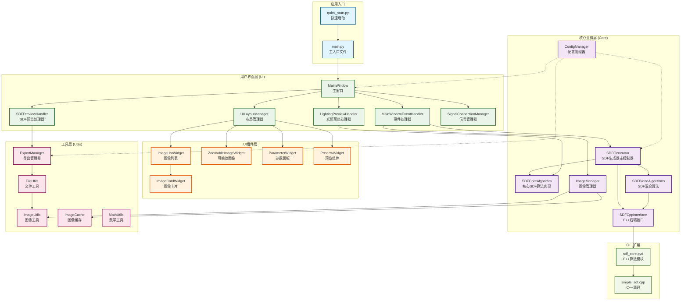

# SDF工具项目架构图

本文档展示了SDF工具项目的整体架构，包括各个模块的层次关系和数据流向。

## 项目架构图

## 架构说明

### 分层架构

项目采用分层架构设计，从上到下分为：

1. **应用入口层**: 程序启动和初始化
2. **用户界面层**: GUI界面和用户交互
3. **UI组件层**: 可复用的界面组件
4. **核心业务层**: 核心算法和业务逻辑
5. **工具层**: 通用工具和辅助功能
6. **C++扩展层**: 高性能算法实现

### 数据流向

#### 主要数据流
1. **用户输入** → UI组件 → 事件处理器 → 核心业务层
2. **算法计算** → 核心业务层 → 预览处理器 → UI更新
3. **文件操作** → 工具层 → 核心业务层 → UI反馈

#### 配置流向
- 配置管理器通过虚线连接到各个需要配置的模块
- 采用依赖注入的方式提供配置信息

### 模块职责

#### 核心业务层 (Core)
- **SDFGenerator**: 算法调度和协调
- **SDFCoreAlgorithm**: 8SSEDT算法实现
- **SDFBlendAlgorithms**: 多种混合策略
- **SDFCppInterface**: C++后端适配
- **ImageManager**: 图像文件管理
- **ConfigManager**: 配置管理

#### 用户界面层 (UI)
- **MainWindow**: 主窗口协调
- **UILayoutManager**: 布局管理
- **EventHandler**: 事件处理
- **PreviewHandlers**: 预览功能
- **SignalManager**: 信号连接

#### 工具层 (Utils)
- **ExportManager**: 文件导出
- **FileUtils**: 文件操作
- **ImageUtils**: 图像处理
- **ImageCache**: 缓存管理

### 设计原则

1. **单一职责**: 每个模块只负责一个特定功能
2. **依赖倒置**: 高层模块不依赖低层模块
3. **开闭原则**: 对扩展开放，对修改封闭
4. **接口隔离**: 使用小而专一的接口
5. **最少知识**: 模块间通过明确接口通信

### 扩展点

1. **算法扩展**: 可以添加新的SDF算法实现
2. **混合策略**: 可以添加新的混合算法
3. **导出格式**: 可以支持更多文件格式
4. **UI组件**: 可以添加新的界面组件
5. **后端支持**: 可以添加GPU等其他后端
