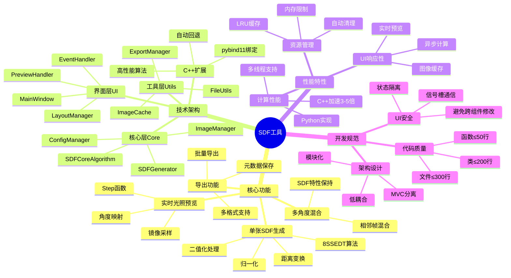

# SDF工具项目概览

本文档提供了SDF工具项目的整体概览，以思维导图的形式展示项目的各个方面。

## 项目概览思维导图

## 项目特色

### 🎯 专业定位
- **专为二次元渲染设计**: 针对动漫、游戏等二次元内容的脸部光照需求
- **SDF技术应用**: 使用先进的有向距离场技术实现高质量光照效果
- **多角度支持**: 支持多个角度的光照图像混合，生成完整的光照贴图

### ⚡ 性能优势
- **双重实现**: Python + C++双重实现，兼顾开发效率和运行性能
- **智能后端**: 自动检测C++扩展可用性，无缝回退到Python实现
- **高效算法**: 基于8SSEDT的优化算法，计算精度高、速度快

### 🎨 用户体验
- **现代界面**: 基于PySide6的现代化GUI界面
- **实时预览**: 光照角度调整时实时显示效果
- **直观操作**: 拖拽导入、一键生成、快速导出的简化工作流程

### 🔧 技术特点
- **严格规范**: 遵循严格的代码规范，文件大小、函数复杂度都有明确限制
- **模块化设计**: 清晰的分层架构，便于维护和扩展
- **安全编程**: UI组件状态隔离，避免跨组件直接修改

## 应用场景

### 游戏开发
- **角色光照**: 为游戏角色生成高质量的脸部光照贴图
- **实时渲染**: 在游戏引擎中使用SDF进行实时光照计算
- **美术工具**: 作为美术工作流程中的专业工具

### 动画制作
- **角色设计**: 为动画角色设计不同光照条件下的表现
- **光照预览**: 快速预览不同光照角度的效果
- **批量处理**: 批量处理多个角色的光照贴图

### 技术研究
- **算法验证**: 验证SDF算法的效果和性能
- **技术学习**: 学习SDF技术和图像处理算法
- **原型开发**: 作为更大项目的原型或组件

## 技术优势

### 算法先进性
- **8SSEDT算法**: 使用业界先进的8点有向距离变换算法
- **多种混合策略**: 提供多种SDF混合算法，适应不同需求
- **Shader兼容**: 光照算法与GPU shader兼容，便于集成

### 架构合理性
- **分层清晰**: Core-UI-Utils三层架构，职责明确
- **低耦合**: 模块间通过接口通信，便于测试和维护
- **可扩展**: 预留扩展点，支持新算法和功能的添加

### 代码质量
- **规范严格**: 文件大小、函数复杂度等都有严格限制
- **重构完成**: 已完成大规模重构，解决了技术债务
- **测试覆盖**: 核心算法有完整的测试覆盖

## 发展规划

### 短期目标
- **性能优化**: 进一步优化算法性能
- **功能完善**: 添加批处理、GPU加速等功能
- **用户体验**: 改进界面和交互体验

### 中期目标
- **生态建设**: 开发插件系统，支持第三方扩展
- **平台支持**: 支持更多操作系统和硬件平台
- **集成能力**: 与主流游戏引擎和建模软件集成

### 长期愿景
- **行业标准**: 成为二次元渲染领域的标准工具
- **技术引领**: 推动SDF技术在实时渲染中的应用
- **开源贡献**: 为开源社区贡献高质量的技术方案

## 学习价值

### 技术学习
- **SDF算法**: 深入理解有向距离场的原理和应用
- **图像处理**: 学习OpenCV、NumPy等图像处理技术
- **GUI开发**: 掌握PySide6/Qt的现代GUI开发

### 工程实践
- **架构设计**: 学习大型项目的架构设计和模块划分
- **代码规范**: 了解严格的代码规范和质量控制
- **性能优化**: 学习Python和C++混合编程的性能优化

### 项目管理
- **重构经验**: 了解大规模代码重构的方法和实践
- **文档管理**: 学习技术文档的编写和维护
- **版本控制**: 掌握Git等版本控制工具的使用

---

*本概览图帮助您快速了解SDF工具项目的全貌，更详细的信息请参考其他技术文档。*
