# SDF工具项目类图

本文档展示了SDF工具项目的完整类图结构，包括核心业务逻辑层、用户界面层、UI组件层和工具层的所有主要类及其关系。

## 类图

```mermaid
classDiagram
    %% 核心业务逻辑层
    class SDFGenerator {
        -core_algorithm: SDFCoreAlgorithm
        -cpp_interface: SDFCppInterface
        -blend_algorithms: SDFBlendAlgorithms
        -last_computation_time: float
        +compute_single_sdf(image_path, threshold, normalize, invert, sdf_direction, max_distance, num_threads, use_cpp_backend)
        +compute_multi_sdf(image_paths, angles, threshold, normalize, invert, blend_mode, sdf_direction, max_distance, num_threads, use_cpp_backend)
        +get_last_computation_time()
    }

    class SDFCoreAlgorithm {
        +load_and_preprocess_image(image_path, threshold)
        +compute_sdf_python(binary_image, normalize, invert, sdf_direction, max_distance)
        +compute_improved_sdf(inside_mask, max_distance)
        +preview_lighting(sdf_data, light_angle, lighting_intensity, ambient_light)
        +calculate_even_angles(num_images)
        +smooth_step(edge0, edge1, x)
    }

    class SDFBlendAlgorithms {
        -cpp_interface: SDFCppInterface
        +blend_multiple_sdfs(sdf_images, angles, blend_mode, use_cpp_backend)
        +blend_sdf_pairwise(sdf_images, angles)
        +blend_weighted(sdf_images, angles)
        +blend_average(sdf_images)
        +blend_max(sdf_images)
        +blend_min(sdf_images)
    }

    class SDFCppInterface {
        -cpp_backend: Module
        -use_cpp_backend: bool
        -cpp_available: bool
        -validator: CppBackendValidator
        -performance_monitor: CppPerformanceMonitor
        +is_available()
        +compute_sdf_cpp(binary_image, normalize, invert, sdf_direction, max_distance, num_threads)
        +blend_multiple_sdfs_cpp(sdf_images)
        +set_use_cpp_backend(use_cpp)
    }

    class ImageManager {
        -images: Dict[str, ImageInfo]
        -cache: ImageCache
        -validator: ImageValidator
        +add_image(file_path)
        +remove_image(file_path)
        +get_image_info(file_path)
        +get_all_images()
        +clear_all()
        +load_image_data(file_path, as_grayscale)
        +load_thumbnail(file_path, size)
        +validate_images()
    }

    class ConfigManager {
        -config_file: Path
        -ui: UIConfig
        -sdf: SDFConfig
        -preview: PreviewConfig
        -export: ExportConfig
        -performance: PerformanceConfig
        -debug: DebugConfig
        +load()
        +save()
        +reset_to_defaults()
        +get_output_directory()
    }

    %% UI层
    class MainWindow {
        -layout_manager: UILayoutManager
        -event_handler: MainWindowEventHandler
        -lighting_handler: LightingPreviewHandler
        -sdf_preview_handler: SDFPreviewHandler
        -signal_manager: SignalConnectionManager
        -components: Dict
        +_init_window()
        +_init_ui()
        +_connect_signals()
        +_on_sdf_generated(sdf_result, computation_time)
        +_on_single_sdf_completed(image_path, sdf_result, computation_time)
    }

    class UILayoutManager {
        -main_window: MainWindow
        +setup_main_layout()
        +setup_menu_bar()
        +setup_status_bar()
        +create_left_panel()
        +create_right_panel()
    }

    class MainWindowEventHandler {
        -main_window: MainWindow
        -sdf_generator: SDFGenerator
        -image_manager: ImageManager
        -current_images: List[str]
        -has_images: bool
        -has_sdf: bool
        +handle_import_images()
        +handle_generate_sdf()
        +handle_export_sdf()
        +handle_clear_all()
        +add_image(file_path)
        +remove_image(file_path)
    }

    class LightingPreviewHandler {
        -main_window: MainWindow
        -merged_sdf: ndarray
        +set_merged_sdf(sdf_data)
        +update_lighting_preview(angle, intensity, ambient)
        +_apply_lighting_effect(sdf_data, angle, intensity, ambient)
    }

    class SDFPreviewHandler {
        -main_window: MainWindow
        +update_single_sdf_card_preview(components, image_path, sdf_result, computation_time)
        +set_all_sdf_cards_completed(components)
        +update_merged_sdf_preview(components, sdf_result)
    }

    class SignalConnectionManager {
        -components: Dict
        -event_handler: MainWindowEventHandler
        -_updating_ui_state: bool
        +connect_all_signals()
        +update_ui_state()
        +_update_image_cards()
        +_update_sdf_cards()
    }

    %% UI组件
    class ImageCardWidget {
        -image_path: str
        -angle: int
        -image_label: QLabel
        -angle_spinbox: QSpinBox
        -remove_btn: QPushButton
        +get_image_path()
        +get_angle()
        +set_angle(angle)
        +_load_and_display_image()
        +_on_remove_clicked()
    }

    class ImageListWidget {
        -image_cards: List[ImageCardWidget]
        -layout: QHBoxLayout
        -max_images: int
        +add_image(image_path, angle)
        +remove_image(image_path)
        +get_all_images_with_angles()
        +clear_all()
        +_redistribute_angles()
    }

    class ZoomableImageWidget {
        -image_data: ndarray
        -zoom_factor: float
        -pan_offset: QPoint
        +set_image(image_data)
        +zoom_in()
        +zoom_out()
        +reset_view()
        +fit_to_window()
    }

    %% 工具类
    class ExportManager {
        +export_sdf_image(sdf_array, file_path, format_type, normalize)
        +export_sdf_data(sdf_array, file_path, format_type, metadata)
        +export_with_dialog(sdf_array, parent_widget, default_name)
        +export_batch_images(sdf_list, output_directory, base_name, format_type)
    }

    class FileUtils {
        +ensure_directory(directory)
        +get_file_extension(file_path)
        +is_image_file(file_path)
        +open_file_dialog(parent, title, file_filter, directory)
        +save_file_dialog(parent, title, file_filter, directory, default_name)
        +export_sdf_image(sdf_array, file_path, format_type, normalize)
    }

    class ImageCache {
        -cache: Dict
        -max_size: int
        -access_times: Dict
        +get(key)
        +put(key, value)
        +clear()
        +load_image_data(file_path, as_grayscale)
        +load_thumbnail(file_path, size)
    }

    %% 关系定义
    SDFGenerator --> SDFCoreAlgorithm
    SDFGenerator --> SDFCppInterface
    SDFGenerator --> SDFBlendAlgorithms
    SDFBlendAlgorithms --> SDFCppInterface
    
    ImageManager --> ImageCache
    ImageManager --> ImageValidator
    ImageManager --> ImageInfo
    
    MainWindow --> UILayoutManager
    MainWindow --> MainWindowEventHandler
    MainWindow --> LightingPreviewHandler
    MainWindow --> SDFPreviewHandler
    MainWindow --> SignalConnectionManager
    
    MainWindowEventHandler --> SDFGenerator
    MainWindowEventHandler --> ImageManager
    
    UILayoutManager --> UIComponentFactory
    UILayoutManager --> ImageListWidget
    UILayoutManager --> ZoomableImageWidget
    
    ImageListWidget --> ImageCardWidget
    
    SignalConnectionManager --> MainWindowEventHandler
    
    ExportManager --> FileUtils
    LightingPreviewHandler --> SDFCoreAlgorithm
```

## 类图说明

### 核心业务逻辑层 (Core)

- **SDFGenerator**: 主控制器，协调各个SDF算法模块
- **SDFCoreAlgorithm**: 核心SDF算法实现，包含8SSEDT算法
- **SDFBlendAlgorithms**: SDF混合算法，支持多种混合策略
- **SDFCppInterface**: C++后端接口，提供高性能计算
- **ImageManager**: 图像管理器，负责图像文件的统一管理
- **ConfigManager**: 配置管理器，管理应用程序的所有配置

### 用户界面层 (UI)

- **MainWindow**: 主窗口，协调各个UI管理器
- **UILayoutManager**: 布局管理器，负责UI布局结构
- **MainWindowEventHandler**: 事件处理器，处理用户交互
- **LightingPreviewHandler**: 光照预览处理器
- **SDFPreviewHandler**: SDF预览处理器
- **SignalConnectionManager**: 信号管理器，管理Qt信号连接

### UI组件层

- **ImageCardWidget**: 图像卡片组件
- **ImageListWidget**: 图像列表组件
- **ZoomableImageWidget**: 可缩放图像组件

### 工具层 (Utils)

- **ExportManager**: 导出管理器，处理文件导出
- **FileUtils**: 文件工具类，提供文件操作功能
- **ImageCache**: 图像缓存，优化图像加载性能

## 设计模式

项目采用了以下设计模式：

1. **MVC模式**: 分离界面、业务逻辑和数据层
2. **策略模式**: SDF混合算法的多种策略
3. **工厂模式**: UI组件的创建
4. **观察者模式**: Qt信号槽机制
5. **缓存模式**: 图像数据的LRU缓存
6. **适配器模式**: C++后端的接口适配
